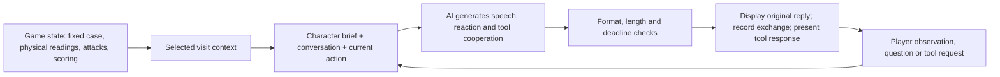

**Current student decision, November 14: autonomous patient dialogue.** The AI uses the patient's background, personality, motives and conversation history to decide what to say and how to react. It generates original responses; it is not restricted to a legal-move list, authored answer bank or fixed dialogue tree. Technical format, length and timeout checks do not select its answer. The earlier enum-constrained protocol is superseded; protocol 3 is now implemented locally and verified with mocks only.

AI use: Claude drafted the initial configuration and code. Codex ran local game and integration checks and updated this document. Final student review is pending.

# Before the Cut: Initial Configuration Document

Version 0.9, G1 Concept, 2026-11-14. The machine-readable version of this document is `agent-config.json` in the project root.

This project has two kinds of agents. They are configured separately and must not be confused.

- **The runtime agent** is inside the game. It plays the patient at the counter (Part A).
- **The production agents** are the coding assistants that help one student build the game (Part B).

Every item carries one of three labels.

| Label | Meaning |
|---|---|
| **Verified** | Built, run, and the result is recorded with its date |
| **Implemented** | Written but not run, or run only against a stand-in |
| **Unresolved** | Planned or undecided |

**Current local verification, November 14:** the revised reference-sheet game runs with optional observation, tools, questions, pressure and reassurance. Autonomous dialogue transport is implemented and tested using local synthetic responses: 260 game/agent assertions, 246 UI-flow assertions, 18 proxy tests and 49 real Godot HTTP/scene integration checks passed. No live model, outside playtest, deployment or standalone export has been validated. These are program checks, not evidence of fun or model quality.

---

# Part A. The runtime agent: an autonomous patient

## A1. Responsibility and inputs

The AI generates the patient's own dialogue and reaction from a character brief, personality, motives, private knowledge, conversation history, visible observations and the latest player action. The character may cooperate, withhold information, evade, argue or change attitude. These are examples, not an exhaustive list of permitted moves. Do not pass an answer menu or force the response through a fixed dialogue tree.

The character brief provides continuity. Include what the patient plausibly knows rather than applying the old blanket ban on private case information. A spoken claim can be mistaken or deceptive; it need not match a predetermined answer string. Keep observed actions and transcript entries distinct so the player can compare them.

## A2. Implemented interface and knowledge boundary

Protocol 3 uses `POST /v1/patient-dialogue`. Request fields are protocol/session/visit/case identifiers, case version, an `event` containing type/id/player text, current visit state and `conversation_history`. The proxy adds the character brief and background facts from its own case data. Response fields are `reply`, `reaction`, and, for tool requests, `cooperates`. There is no legal-move list or answer enum.

**Boundary:** the game owns the fixed case assessment, exact physical readings, attack choreography and score. The AI receives character knowledge, motives, patience/cooperation history and the actual conversation. It does not receive the entire hidden case file or a list of correct answers. Speech can be mistaken or deceptive and is recorded as speech, not an instrument result. Tool cooperation affects access to an examination; the model does not reroll its physical reading. Additional observation context is an open integration detail.

Generated interpersonal reactions are displayed as text. Existing physical animations and attacks remain engine-controlled; arbitrary model-generated physical actions are not implemented.

## A3. Prompt artifact and context

Use `agent_team/patient-character-prompt.md` as the current prompt brief. The first slice can keep authored player questions and tone choices to limit UI work; the patient's answer is still generated. Free-text player input is an optional later decision, not a prerequisite for autonomous replies.

Preserve a bounded transcript and a factual visit summary when needed. Session isolation must prevent one patient's history from entering another visit. What the character remembers and knows must be recorded in the case brief. No fixed diagnosis sentence or compulsory secret disclosure is required.

## A4. Technical validation and service failure

Check request/response shape, nonempty text, output length, timeouts and provider errors. Do not compare generated speech with an approved-answer list. A surprising answer is not automatically a transport error. Report character contradictions during evaluation rather than silently substituting a script for every unexpected response.

On connection failure or timeout, use an explicitly labelled authored offline fallback and keep other examination choices available. Label the result as fallback in logs. A separate scripted mode supports offline development and the comparison study. Neither fallback nor the comparison controls normal successful model replies.

## A5. Targets and cost

Provisional targets retained for planning: typical response within 1 second; hard timeout around 2.5 seconds; one attempt per request; at most 256 output tokens; at most four model requests per visit. These limits manage responsiveness and expense, not dialogue content. Re-evaluate them with actual conversations.

Budget target: at most USD 0.02 per shift. Earlier calculations assumed roughly ten calls, 730 input tokens and 60 output tokens each, producing about USD 0.004 under the recorded price assumptions. Those were estimates for the previous protocol. New character context and conversation history require fresh token, latency and cost measurements. Provider access and model choice remain unresolved. Do not present the old estimate as a measured cost of autonomous dialogue.

## A6. Evaluation and logging

Compare the same patient briefs and player scenarios in generated and authored-dialogue conditions. Inspect character continuity, relevance to the question, changes in attitude, believable deception and whether players change their next check. Ask players to explain their conclusions. Measure latency, token usage, cost and fallback frequency. Refusal or irritation alone must not be treated as a diagnosis.

Current logs contain action identifiers, source (`model`, `script`, `fallback`), timing and available usage metadata. The conversation stays in bounded visit memory. For evaluation, collect consented, anonymized conversation excerpts separately; do not persist raw player text by default. Keep credentials server-side and player identifiers out of test reports. Obtain outside playtest observations; automation is not a substitute.

## A7. Current implementation

**Current local verification, November 14:** the revised reference-sheet game runs with optional observation, tools, questions, pressure and reassurance. Autonomous dialogue transport is implemented and tested using local synthetic responses: 260 game/agent assertions, 246 UI-flow assertions, 18 proxy tests and 49 real Godot HTTP/scene integration checks passed. No live model, outside playtest, deployment or standalone export has been validated. These are program checks, not evidence of fun or model quality.

The implementation uses `patient_agent.gd`, `model_client.gd`, `move_validator.gd` (a retained filename for format validation), `visit_state.gd`, `main.gd`, and `agent_proxy/src/core.mjs`. The offline `scripted_brain.gd` is a comparison/fallback only. Tests cover novel speech surviving unchanged, cooperation outside authored options, per-patient memory reset, malformed transport, deadlines and actual scene display.

The public repository currently hosts documents; implementation source still lives in the active development workspace. A newer Trauma Team sequence was found in the active source and still needs a focused play check. An authorized live provider, deployment and human evaluation remain pending.

## A8. Historical evidence

November 12 results covered the earlier prototype: 269 game-rule assertions, 141 UI-flow assertions, 28 proxy tests and 73 real-client mock integration checks. They establish earlier transport/fallback feasibility, not the new dialogue experience. No live-model or human-playtest result is recorded. The previous configuration is preserved in Git history and the local revision archive.

The ongoing repository is https://github.com/DemonRain7/before-the-cut. Documents are under `docs/g1/`; implementation source transfer is deferred while Claude/Fable is still writing in the legacy workspace. CI and deployment remain pending.

## A9. Budget basis and the concrete comparison

For the proposed three-patient slice, four requests per patient gives at most 12 requests. A planning allowance of 930 input and 256 output tokens per request, using the dated price assumptions of $0.30/million input and $2.50/million output tokens, gives `12 × (930 × 0.30 + 256 × 2.50) / 1,000,000 = $0.011028` before hosting. The $0.02/shift target provides headroom; it is not a measured price. The current five-patient development shift would allow 20 requests and about $0.01838 under the same assumptions, leaving little headroom. Provider access, current pricing and growing history must be remeasured before committing to that larger scope.

Latency target: 1 second for a typical response, 2-second proxy deadline and 2.5-second client timeout. These are targets/caps, not measured live-model performance.

The implemented authored comparison covers specific questions and tone choices. A new combination or player follow-up receives no bespoke answer unless it is authored. The AI hypothesis is that a character can address that combination spontaneously and thereby change the next examination choice. This is the concrete possible loss under the chosen baseline; scripts in general are not incapable of responsive characters. Test relevance, continuity, the player's next action and their explanation, not wording variety alone.

---

# Part B. The production agent team

## B1. Who decides

The student is Executive Producer and Creative Director: sets the concept, approves scope and content, runs and judges the game, records and submits. The instructor is the Gate Approver. Agents propose, write and check. The student controls course submission, spending and gate decisions. Agents may publish repository materials under explicit student authorization; the student requested G1 document publication and the subsequent repository rename and restructuring on November 14. No CourseWorks post was made.

## B2. What has actually happened so far

- **2026-11-10 to 11, Codex** (a coding agent): course research, a comparison of game directions, the First Pitch draft, the G1 preparation notes and the handoff note. These are the older Chinese-language notes in the project root.
- **2026-11-11, Claude Code** (a coding agent): rule set v0.1, the three patients, the Godot project, the proxy and its tests, the lint tool, and the drafts in this G1 folder.
- **2026-11-12, Codex:** resumed from the code, installed portable Godot, ran local tests, added real-client integration checks, captured actual frames, completed the G1 deck and handoff records.
- **2026-11-13, the student:** corrected the concept to observation-guide comparison and action-based screening, and requested corresponding material changes. Codex revised the design and pitch; the optional flow was subsequently implemented and tested locally on November 14.
- **2026-11-14, Claude/Fable and Codex:** Claude/Fable developed the revised five-patient pixel-art build. Codex migrated the patient dialogue path to autonomous generation and ran the current local checks. The student recorded the presentation and is reviewing the submission. No outside playtest is claimed.

So today there is one working production role, the implementation agent, used by two different tools in turn. The other roles below are a plan with two artifacts already written and not yet used.

## B3. Role coverage

| Role | Executable artifact | Purpose | Context it reads | Tools and permissions | Outputs | Handoff to | How it is checked | Human approval boundary | Label |
|---|---|---|---|---|---|---|---|---|---|
| **Producer** | `HANDOFF.md`, `NEXT_AGENT_PROMPT.md`, the plan and risk register in this folder | Keep scope, dates, risks and the next three tasks current | `HANDOFF.md`, this folder, course dates | Read and write project files. No posting, no gate decisions | Updated plan, risks, handoff | Student, then the next agent | A fresh agent can state the goal, run the checks and name the next task from the handoff alone | Student sets priorities and accepts every scope change | Implemented during Codex resumption. Fresh-agent handoff usability remains to be checked |
| **Design Lead and Narrative** | `agent_team/case-author/SKILL.md` | One procedure for adding or changing a patient so the rules stay fair | `rules.json`, the case files, the GDD, `AGENTS.md` | Edits only `game/data/cases` and test expectations | A case file, updated expectations, a change note | Rules reviewer | Guide entries support each authored response and verdict; relevant tests cover the revised rule schema. Old strategy totals are historical until rebalanced | Student approves each patient's truth and tone | Implemented (written, not used) |
| **Tech Lead** | `AGENTS.md` | Build and change the game and the proxy | `AGENTS.md`, `HANDOFF.md`, the code | Read and write the project, run local tests. No secrets in files. Routine local setup and reversible fixes follow the student's task authorization. No paid calls, publication or unrelated changes without authorization | Code, tests, real test output, updated handoff | Rules reviewer and student | The four test commands | Student runs the game, accepts the change, commits | Verified in use (two agents so far) |
| **QA** | `agent_team/rules-reviewer.md`, `tools/gd_static_check.py`, `game/tests/`, `agent_proxy/test/` | An independent check, in a context that did not write the change | The diff and change note, the data files, the rule code | Read and search only | Findings with file and line, or "No findings" | Student; blocking findings go back to the Tech Lead | Planned: seed a known fault and confirm it is found | Student decides every finding. The reviewer cannot approve or merge | Reviewer brief implemented (not used). Proxy and game tests verified. The separate reviewer workflow remains unexercised |
| **Art Lead** | Procedural art scripts under `tools/art/` and pixel assets under `game/assets/` in the development workspace; consolidated art brief planned | Readable look spots first, pixel art later | The GDD's feedback section, the UI code | Would write under `game/assets`. Third-party assets only with recorded license terms | Sprites and a license log | Tech Lead | A new player can describe the visible response and find the matching guide entry | Student approves the look | Unresolved |
| **Audio** | Planned: a list of at most six sounds | A sound for the warning and the shutter | The GDD | Same as Art Lead | Sound files with license terms | Tech Lead | The warning is noticed without reading | Student approves | Unresolved. First to be cut |
| **Business Intelligence** | `game/scripts/core/event_log.gd`. Planned: a log summary script | Turn play logs into the few numbers the playtest question needs | Session logs | Read logs, write summaries. No identities | A per-session table | Student | Numbers match a hand count on one session | Student writes the interpretation | Log writer verified in local tests. BI summary tool unresolved |
| **Publishing and Release** | `game/README.md`, `README.md`. Planned: an export checklist | Make the build reachable and runnable by a playtester | The READMEs, course publishing guidance | Local export only. Deployment or any public post needs the student's explicit go-ahead | A Windows build, run instructions, a submission checklist | Student | Someone who has not seen the project runs it from the README | Student records and approves submissions; agents may publish repository files when authorized | Run instructions implemented (not yet followed by a person) |

## B4. The executable artifacts

The course asks for at least one agent delivered as a skill, plugin, tool bundle, MCP server, function-calling interface or equivalent. The plan, with today's state:

| # | Artifact | Kind | State |
|---|---|---|---|
| 1 | `agent_proxy/`: protocol-3 patient dialogue in the development workspace | JSON transport with free speech/reaction text | 18 current proxy tests and 49 Godot HTTP/scene checks passed with mocks; no live model |
| 2 | `agent_team/case-author/SKILL.md` | Skill, in the common `SKILL.md` format | Implemented. Not yet used on a real change |
| 3 | `agent_team/rules-reviewer.md` | Reviewer brief for a separate agent context | Implemented. Not yet used |
| 4 | `tools/gd_static_check.py` | Tool | Verified: runs and reports |
| 5 | `AGENTS.md` | Shared standing instructions for any coding agent | In use |

Personal agent settings live in `.claude/`, which Git ignores. Shared team artifacts therefore live in the tracked `agent_team/` folder so that any agent or person can use them. To use the skill in Claude Code, copy the `case-author` folder into `.claude/skills/`. In another tool, point the agent at the file.

## B5. How work moves between roles

1. The student states a change ("add a patient who fakes calm").
2. The Design Lead skill produces the case file and updates the expected results.
3. The Tech Lead runs the test commands and records the real output.
4. The rules reviewer, in a fresh context, reads the diff and reports findings.
5. The student plays the change, decides on the findings, and commits.
6. The Producer updates the handoff, plan and risks.

Steps 2 and 4 have not been exercised yet.

## B6. Gaps

- G1 documents are public in the ongoing repository. Source transfer waits for the active implementation writer to stop; CI is not configured.
- The reviewer has never run, so its usefulness is unknown.
- New procedural pixel-art assets and generation scripts have been observed in the active workspace but are not yet reviewed or transferred. Audio, log analysis and release verification remain unconfirmed.
- One student is the only human check. There is no second person to catch what the student and the agents both miss. External playtesters are the planned counterweight.

---

# Part C. Summary of labels

| Area | Verified | Implemented, not run | Unresolved |
|---|---|---|---|
| Runtime agent | Local proxy and game validators, fallback and logs. Real HTTP mock shift and deadline paths | Google adapter tested only against fake fetch | Live model call, real latency and cost, leak check, deployment, shared limit storage |
| Baseline | Earlier build: three cases, five strategy totals, four UI-flow shifts and the 10-turn mock comparison | | Fairness with live generated dialogue, Trauma Team outcome wording, revised comparison and player evaluation |
| Production team | Implementation agent in use; lint; proxy tests | Case-author skill; reviewer brief; handoff set | CI; art, audio, analysis and release artifacts; a first independent review |
| Evidence from people | | | Any playtest |
